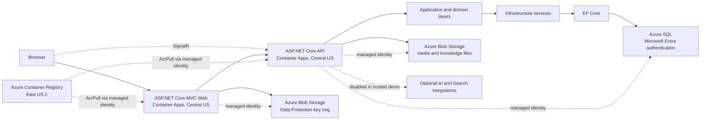

# AI Emergency Response

[](https://github.com/AmarjeetJha17/AI-Emergency-Response/actions/workflows/ci.yml)
[](https://github.com/AmarjeetJha17/AI-Emergency-Response/actions/workflows/codeql.yml)
[](LICENSE)

An incident-management and coordination platform for collecting reports, reviewing hazards, organizing response resources, and maintaining operational context. The repository contains an ASP.NET Core Web application and API, domain and application layers, SQL persistence, Azure deployment definitions, and local synthetic-demo tooling.

**Portfolio demo status (26 October 2026):** the Web and API applications are deployed to Azure Container Apps in Central US. The maintainer verified the Web homepage and login, both application health endpoints (HTTP 200), SQL connectivity, and that API AI inference is disabled. These checks demonstrate a hosted portfolio environment, not operational readiness or a complete emergency-response workflow.

[Open the demo](https://ca-er-web-portfolio.blacksand-fa4db74f.centralus.azurecontainerapps.io/) · [API readiness](https://ca-er-api-portfolio.blacksand-fa4db74f.centralus.azurecontainerapps.io/health/ready) · [GitHub repository](https://github.com/AmarjeetJha17/AI-Emergency-Response)

This is a software portfolio project, not an emergency-services system. Do not use it to report or coordinate real emergencies.

## Overview

Emergency coordination involves overlapping reports, changing conditions, limited resources, and decisions that need an audit trail. This application brings incident reporting, geographic context, resources, escalations, and operational knowledge into a single interface. Optional AI components can extract facts and offer recommendations; deterministic rules evaluate severity and priority. Human review remains essential.

Deterministic business rules evaluate severity and priority. Optional AI components can extract information and offer recommendations in configured environments. Human review and authenticated commands are the intended controls. Known authorization and recovery gaps still block operational use; see the [feature evidence and limitations](docs/portfolio/feature-verification.md).

## Key capabilities

### Incident management and intelligence

- Incident creation, retrieval, filtering, pagination, locations, and status history.
- Structured AI fact extraction and candidate classification with review states.
- Deterministic severity and priority scoring.
- Duplicate candidates combining embeddings, geography, time, and incident type; human review before confirming relationships.
- Image/video evidence flows, file validation, and visual-review components. AI-assisted visual analysis is disabled in the hosted demo; video processing requires runtime tools not included in the current API image.

### Operational coordination

- Dashboards, Leaflet incident/resource maps, and command-center views.
- Resource recommendations, assignments, state transitions, concurrency controls, and audit history.
- Escalation acknowledgment/resolution and clustering of operational situations.
- Persistent notifications and SignalR update hints with API snapshot refresh after reconnect.
- Recipient and action authorization exist but need further hardening; their presence does not prove every route is correctly isolated.

### Generative AI and knowledge

- PDF, DOCX, text, and Markdown knowledge processing, chunks, embeddings, and Azure AI Search retrieval.
- Copilot citations, grounding checks, conversation memory, and feedback.
- Read-only tools for incidents, resources, situations, predictions, notifications, and environmental context.
- Controlled proposals with explicit approval, expiry, revalidation, and audit. Executable actions currently add incident **notes or tags**, not dispatch responders.

### Predictive intelligence

- ML.NET escalation-risk and forecasting components, resource-demand and geographic-hotspot analysis.
- Versioned feature snapshots and temporal evaluation foundations.
- The checked-in escalation model is a development artifact with zero recorded training/validation/test rows; operational accuracy is not established.

### Reliability and engineering

- Identity, JWT/cookie authentication, permissions, EF Core migrations, and SQL persistence.
- Transactional outbox and Azure Service Bus for selected incident jobs.
- Logging, health checks, telemetry declarations, and dependency-failure handling.
- Unit/SQL integration tests, offline AI evaluation, NBomber smoke workloads, security scanning, Docker packaging, and Bicep infrastructure definitions.

These describe codebase components, not a claim that every workflow or external provider is active in the hosted demo. Resource assignment does not dispatch responders or contact emergency authorities. Several queues remain in memory, workers run inside the API, and some retry/side-effect paths are not crash-safe.

**Hosted demo AI status:** `AI__Enabled=false`. No live Azure OpenAI inference, computer-vision analysis, AI-generated Copilot responses, or operational predictive-AI results are claimed for the deployed demo. AI-dependent operations are configured to return a controlled disabled response.

## Architecture



The hosted portfolio uses separate ASP.NET Core MVC Web and ASP.NET Core API Container Apps in Central US. The API uses EF Core with Azure SQL and managed identities for SQL and Blob Storage access; both apps use managed identities to pull images from the East US 2 registry. The Web app stores Data Protection keys in Blob Storage without Key Vault wrapping in this synthetic-only demo. The browser also connects directly to the API SignalR hub. There is **no standalone Worker host**; selected queues remain process-local. Optional AI/Search integrations shown in the broader codebase are not active in this deployment. See [architecture notes](docs/architecture) and the [network contract](docs/deployment/network-architecture.md).

## Technology stack

| Area | Technologies |
|---|---|
| Backend | C#, .NET 10, ASP.NET Core MVC/Web API, EF Core |
| Data | SQL Server 2025, relational models, migrations, row versions, native vectors |
| AI/ML | Microsoft.Extensions.AI, Azure OpenAI/Foundry, embeddings, RAG, structured outputs, ML.NET |
| UI/realtime | Razor, JavaScript, SignalR, Leaflet, Bootstrap, Syncfusion |
| Quality/operations | xUnit, Moq, Coverlet, CodeQL, dependency review, NBomber, Docker, Azure Bicep |
| Azure target | Container Apps, Azure SQL, Blob Storage, Container Registry, Log Analytics, managed identities; optional Key Vault, Search, and Service Bus integrations |

Syncfusion is separately licensed and its key is required at Web startup. Obtain your own valid license; it is not included in this repository.

## Testing and evidence

CI restores/builds the solution, checks pending EF model changes, runs unit and SQL-backed integration tests, evaluates offline AI fixtures, executes a performance smoke workload, and enforces **70% combined Domain/Application line coverage**. Container image builds and Bicep compilation are additional quality jobs. CodeQL and dependency review run separately.

Verified snapshot for portfolio commit `41aadf9` (CI on 2026-10-14 UTC): **509 unit tests**, **86 SQL integration tests**, and **79.46% combined Domain/Application coverage**, all passing. Docker builds, Bicep compilation, CodeQL and dependency review also passed. [Run evidence](https://github.com/AmarjeetJha17/AI-Emergency-Response/actions/runs/38534715013). This is a dated result, not a guarantee about another commit or coverage of Infrastructure/Web/API.

The live-AI workflow can skip successfully when provider settings are missing. Its green badge alone is not real-model evaluation evidence. A short local/CI workload is not production capacity. The 2026-10-17 baseline regression run passed the Release build (49 warnings, 0 errors), 572 unit tests, 89 SQL integration tests against the dedicated `EmergencyResponse_IntegrationTests` database, 28 UI JavaScript tests, and JavaScript syntax checks. These checks predate later API startup, SignalR logging, and Copilot conversation-memory changes. Current 2026-10-18 screenshots provide bounded desktop evidence for the dashboard, incident queue/report form, map, duplicate review, notifications, Copilot question form, Resource Command Center, and Situation Center; they do not establish responsive or end-to-end acceptance. The Resource Command Center was still loading eligible incidents, the Situation Center showed no active situations, and no Copilot response was captured. The Copilot EF tracking fix has a regression test, but the focused build/test attempt stopped during project-reference SDK resolution on this host before compiling or running tests. See the dated [portfolio register](docs/portfolio/feature-verification.md), [UI verification](docs/portfolio/ui-ux-verification.md), [screenshot index](docs/portfolio/screenshots/README.md), [testing docs](docs/testing), and actual [Actions history](https://github.com/AmarjeetJha17/AI-Emergency-Response/actions).

## Deployment and safety status

The hosted portfolio demo uses the isolated templates `infra/portfolio-demo-api.bicep` and `infra/portfolio-demo-web.bicep`. The broader staging and pilot deployment is separate and remains **NO-GO**; see the [pilot decision](docs/deployment/pilot-go-no-go.md) and [staging report](docs/deployment/staging-verification.md). The deployment record contains a dated history; its earlier statements that apps were absent describe those earlier checkpoints, not the current demo.

The deployed Web app runs in `PortfolioDemo` and persists Data Protection keys to Blob Storage **without Key Vault wrapping**. This is a reduced-security fallback strictly for synthetic demonstration data. Do not use it for real users, sensitive data, or production. The API's JWT key and initial admin password, and the Web Syncfusion license, are supplied as Container Apps secrets; no secret values belong in this repository.

The hosted homepage/login, health endpoints, SQL connectivity, and AI-disabled configuration have been verified by the maintainer. Full end-to-end workflows, real AI provider behavior, emergency-authority integration, durable-job recovery, alert delivery, and restoration are not established. This project is **not approved for real-world emergency operations**.

- In environments where AI is enabled, classifications, forecasts, and Copilot answers are advisory and require verification. AI is disabled in the hosted demo.
- Authorization gaps, process-local jobs, retry semantics, and crash recovery require correction before a pilot.
- Video runtime dependencies and malware-scanning integration are incomplete.
- Do not use this development project to coordinate real emergencies.

### Reproducing the Azure portfolio deployment

Reproduction requires an Azure subscription and deployment permissions, the Central US resource group and Container Apps environment with its VNet/subnet and Log Analytics workspace, the existing East US 2 Container Registry and immutable images, Azure SQL with Entra authentication and a contained API identity, Blob Storage containers for media/knowledge/Data Protection, and user-assigned identities with narrowly scoped registry, SQL, and Storage access. The API and Web also require secure runtime values (JWT signing key, initial admin password if the account must be seeded, and a valid Syncfusion license). Follow the isolated templates and current-state notes in the [portfolio deployment record](docs/deployment/cost-conscious-portfolio-demo.md); do not use the broad staging/pilot templates as a shortcut. AI model deployment and inference permissions are not prerequisites for this demo. Azure resources incur charges, so check current resource state and cost before provisioning or leaving services running.

## Repository structure

```text
src/      Domain, Application, Infrastructure, Api, Web
tests/    UnitTests, IntegrationTests, CopilotEvaluation, LoadTests
ml/       EmergencyResponse.PredictiveTraining
tools/    EmergencyResponse.SearchIndexProvisioner, EmergencyResponse.DemoData
infra/    Azure Bicep foundation, apps, preview, migration-runner templates
docker/   Web and API Dockerfiles
scripts/  Quality, deployment, and recovery utilities
docs/     Architecture, security, testing, deployment, portfolio evidence
```

## Getting started

Prerequisites: .NET 10 SDK, SQL Server 2025, and environment-specific configuration. Running the Web app also requires a valid Syncfusion license. Full AI/RAG workflows require configured providers and permitted access; there is no general offline demo provider.

From the repository root:

```powershell
dotnet tool restore
dotnet restore AI-Emergency-Response.slnx
dotnet build AI-Emergency-Response.slnx --configuration Release
dotnet test tests/EmergencyResponse.UnitTests/EmergencyResponse.UnitTests.csproj --configuration Release
```

These commands build the project; they do not configure services or migrate a database. API startup applies pending EF migrations before seeding in **Development** and **Test** only. Development startup can therefore change the configured database: verify its server and database name, review pending migrations, and back up retained data before starting the API. Production startup does not auto-migrate; use a reviewed release migration process. Follow the [local setup and synthetic demo script](docs/portfolio/demo-script.md) before starting API/Web or importing fixtures.

Runtime secrets belong in User Secrets or environment variables. SQL test settings are intentionally empty in tracked files: supply `ConnectionStrings__TestDatabase` and `ConnectionStrings__LoadTestDatabase` for the dedicated disposable databases. Test setup can reset data; never point it at a shared or production database.

## Portfolio walkthrough

For the hosted demo, open the Web homepage, sign in using credentials supplied privately by the maintainer, then check the API readiness URL above. Current verified scope is homepage/login, both health endpoints, SQL connectivity, and AI disabled; verify any other pages during the session before presenting them as working. Use synthetic data only. For the local engineering walkthrough, see the [3–5 minute demo walkthrough](docs/portfolio/demo-walkthrough.md) and [local setup guide](docs/portfolio/demo-script.md). The [portfolio deck](docs/portfolio/AI-Emergency-Response-Portfolio-Deck.pptx) and [editable Markdown source](docs/portfolio/project-presentation.md) summarize the architecture and evidence boundaries. The [screenshot index](docs/portfolio/screenshots/README.md) contains historical local captures, not screenshots of this hosted release. Useful new captures would include the current homepage/login, a synthetic incident report/details view, the operational map/dashboard, and the readiness response; none are fabricated or claimed here.

The [DEMO18 dataset](docs/portfolio/synthetic-demo-data.md) imports six clearly marked synthetic reports, six resources, manual escalations, a manually grouped situation, and review reminders into an isolated local database. Import is idempotent and cleanup is ownership-scoped, but cleanup refuses to remove later application-owned evidence. The fixtures do not run AI, confirm duplicate relationships, send notifications, or dispatch resources. Local automated checks and selected authenticated MVC/API responses have passed at dated checkpoints. Current hosted-release screenshots and live AI/duplicate assessments are not included or claimed.

## Current verification status

- **Implemented:** the application and local demo tooling described above.
- **Verified locally:** dated build, unit, isolated SQL integration, JavaScript, and selected authenticated MVC/API checks listed in the verification register.
- **Partially verified:** historical 2026-10-15 map/resource/detail captures and owner-provided 2026-10-17 local Map/Login screenshots. The new Map screenshot shows a connected SignalR session at a 1230 × 1285 emulated viewport, but its open Console exposed an access token in the SignalR URL. It was not added to the portfolio screenshot set; re-capture after the logging fix with DevTools closed. No full workflow, role matrix, or responsive acceptance is established.
- **Not verified:** current visual layouts at desktop/tablet/mobile sizes, a complete end-to-end walkthrough, fresh all-role browser workflows, live AI grounding quality, full SignalR recovery, or operational integration with emergency authorities.
- **Hosting:** the Central US portfolio Web and API apps are deployed, and the maintainer reports homepage/login, HTTP 200 health checks, SQL connectivity, and AI-disabled mode verified. This is not a verified staging/pilot deployment or approval for real emergencies. The timed local walkthrough remains unexecuted end to end.

More detail: [feature verification](docs/portfolio/feature-verification.md), [UI verification](docs/portfolio/ui-ux-verification.md), [synthetic dataset](docs/portfolio/synthetic-demo-data.md), and [screenshot evidence](docs/portfolio/screenshots/README.md).

## Roadmap

1. Correct action/recipient authorization gaps and complete durable processing/retry recovery.
2. Resolve staging provisioning and verify private routing, identities, migrations, and service access.
3. Demonstrate end-to-end workflows, monitoring, sustained load, and restoration.
4. Validate model quality and conduct the tabletop and pilot go/no-go review.
5. Publish a versioned portfolio release with reproducible evidence; expand deployment only after required approvals.

## License

Project-owned code is available under the [MIT License](LICENSE). Third-party libraries, copied vendor assets, map tiles, models, and external services retain their own licenses and terms. Existing vendor notices are preserved; MIT does not grant a Syncfusion license or rights to external provider content.
