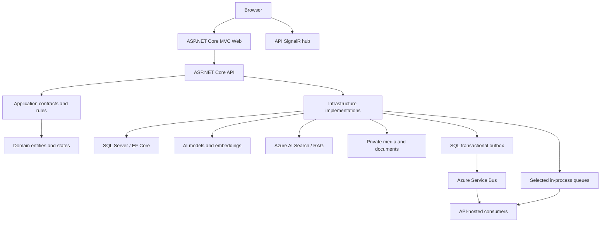

# AI Emergency Response & Disaster Management Platform

[](https://github.com/AmarjeetJha17/AI-Emergency-Response/actions/workflows/ci.yml)
[](https://github.com/AmarjeetJha17/AI-Emergency-Response/actions/workflows/codeql.yml)
[](LICENSE)

An AI-assisted emergency incident management and disaster coordination platform built with C#, .NET 10, ASP.NET Core, SQL Server, Azure AI, and ML.NET.

**Status: active development.** Automated quality checks are operating. Azure staging deployment, complete durable-job recovery, and pilot acceptance have not been verified. This project is **not approved for real-world emergency operations**. The portfolio presents implemented engineering work and its current limits; a hosted demo is deferred.

## Overview

Emergency coordination involves overlapping reports, changing conditions, limited resources, and decisions that need an audit trail. This application brings incident reporting, AI-assisted triage, geographic context, resources, escalations, and operational knowledge into a single interface.

AI extracts information and offers recommendations. Deterministic business rules evaluate severity and priority. Human review and authenticated commands are the intended operational controls. Known authorization and recovery gaps still block operational use; see the [feature evidence and limitations](docs/portfolio/feature-verification.md).

## Key capabilities

### Incident management and intelligence

- Incident creation, retrieval, filtering, pagination, locations, and status history.
- Structured AI fact extraction and candidate classification with review states.
- Deterministic severity and priority scoring.
- Duplicate candidates combining embeddings, geography, time, and incident type; human review before confirming relationships.
- Private image/video evidence, file validation, visual analysis, and bounded video frame extraction. The current container lacks the tools required for video processing.

### Operational coordination

- Dashboards, Leaflet incident/resource maps, and command-center views.
- Resource recommendations, assignments, state transitions, concurrency controls, and audit history.
- Escalation acknowledgment/resolution and clustering of operational situations.
- Persistent notifications and SignalR update hints with API snapshot refresh after reconnect.
- Recipient and action authorization exist but need further hardening; their presence does not prove every route is correctly isolated.

### Generative AI and knowledge

- PDF, DOCX, text, and Markdown knowledge processing, chunks, embeddings, and Azure AI Search retrieval.
- Copilot citations, grounding checks, conversation memory, and feedback.
- Read-only tools for incidents, resources, situations, predictions, notifications, and environmental context.
- Controlled proposals with explicit approval, expiry, revalidation, and audit. Executable actions currently add incident **notes or tags**, not dispatch responders.

### Predictive intelligence

- ML.NET escalation-risk inference/training, volume forecasting, resource demand, and geographic hotspots.
- Versioned feature snapshots and temporal evaluation foundations.
- The checked-in escalation model is a development artifact with zero recorded training/validation/test rows; operational accuracy is not established.

### Reliability and engineering

- Identity, JWT/cookie authentication, permissions, EF Core migrations, and SQL persistence.
- Transactional outbox and Azure Service Bus for selected incident jobs.
- Logging, health checks, telemetry declarations, and dependency-failure handling.
- Unit/SQL integration tests, offline AI evaluation, NBomber smoke workloads, security scanning, Docker packaging, and Bicep infrastructure definitions.

Availability and verification vary by subsystem. Several queues remain in memory, workers run inside the API, and some retry/side-effect paths are not crash-safe.

## Architecture



The browser currently connects directly to the API SignalR hub. Deployment definitions retain configurable external API ingress for that route. There is **no standalone Worker host** yet; separate containers cannot share in-memory channels. See [architecture documentation](docs/architecture) and the [network contract](docs/deployment/network-architecture.md).

## Technology stack

| Area | Technologies |
|---|---|
| Backend | C#, .NET 10, ASP.NET Core MVC/Web API, EF Core |
| Data | SQL Server 2025, relational models, migrations, row versions, native vectors |
| AI/ML | Microsoft.Extensions.AI, Azure OpenAI/Foundry, embeddings, RAG, structured outputs, ML.NET |
| UI/realtime | Razor, JavaScript, SignalR, Leaflet, Bootstrap, Syncfusion |
| Quality/operations | xUnit, Moq, Coverlet, CodeQL, dependency review, NBomber, Docker, Azure Bicep |
| Azure target | Container Apps, private SQL/Blob/Search endpoints, Service Bus, Key Vault, managed identities |

Syncfusion is separately licensed and its key is required at Web startup. Obtain your own valid license; it is not included in this repository.

## Testing and evidence

CI restores/builds the solution, checks pending EF model changes, runs unit and SQL-backed integration tests, evaluates offline AI fixtures, executes a performance smoke workload, and enforces **70% combined Domain/Application line coverage**. Container image builds and Bicep compilation are additional quality jobs. CodeQL and dependency review run separately.

Verified snapshot for portfolio commit `41aadf9` (CI on 2026-10-14 UTC): **509 unit tests**, **86 SQL integration tests**, and **79.46% combined Domain/Application coverage**, all passing. Docker builds, Bicep compilation, CodeQL and dependency review also passed. [Run evidence](https://github.com/AmarjeetJha17/AI-Emergency-Response/actions/runs/38534715013). This is a dated result, not a guarantee about another commit or coverage of Infrastructure/Web/API.

The live-AI workflow can skip successfully when provider settings are missing. Its green badge alone is not real-model evaluation evidence. A short local/CI workload is not production capacity. The latest local regression run on 2026-10-17 passed the Release build (49 warnings, 0 errors), 572 unit tests, 89 SQL integration tests against the dedicated `EmergencyResponse_IntegrationTests` database, 28 UI JavaScript tests, and JavaScript syntax checks. The warnings include existing vulnerability advisories and nullable-reference warnings. This run did not verify browser rendering or live AI. See the dated [portfolio register](docs/portfolio/feature-verification.md), [UI verification](docs/portfolio/ui-ux-verification.md), [testing docs](docs/testing), and actual [Actions history](https://github.com/AmarjeetJha17/AI-Emergency-Response/actions).

## Deployment and safety status

Azure Bicep defines the target VNet, private SQL/storage/search connectivity, identities, registry, messaging, and Web/API apps. The latest [staging report](docs/deployment/staging-verification.md) records provisioning blocked by a Container Apps environment quota/deletion issue. It is recorded evidence, not a live Azure-state query.

Private routing, deployed identities, migrations, end-to-end workflows, alert delivery, and restoration remain unverified. The [pilot decision](docs/deployment/pilot-go-no-go.md) remains **NO-GO**.

- AI classification, forecasts, and Copilot answers are advisory and require verification.
- Authorization gaps, process-local jobs, retry semantics, and crash recovery require correction before a pilot.
- Video runtime dependencies and malware-scanning integration are incomplete.
- Do not use this development project to coordinate real emergencies.

## Repository structure

```text
src/      Domain, Application, Infrastructure, Api, Web
tests/    UnitTests, IntegrationTests, CopilotEvaluation, LoadTests
ml/       EmergencyResponse.PredictiveTraining
tools/    EmergencyResponse.SearchIndexProvisioner, EmergencyResponse.DemoData
infra/    Azure Bicep foundation, apps, preview, migration-runner templates
docker/   Web and API Dockerfiles
scripts/  Quality, deployment, and recovery utilities
docs/     Architecture, security, testing, deployment, portfolio evidence
```

## Getting started

Prerequisites: .NET 10 SDK, SQL Server 2025, and environment-specific configuration. Running the Web app also requires a valid Syncfusion license. Full AI/RAG workflows require configured providers and permitted access; there is no general offline demo provider.

From the repository root:

```powershell
dotnet tool restore
dotnet restore AI-Emergency-Response.slnx
dotnet build AI-Emergency-Response.slnx --configuration Release
```

These commands build the project; they do not configure services or migrate a database. Development API startup runs seeders but does not apply migrations. Apply migrations explicitly to the intended local database after checking its server and database name. Follow the [local setup and synthetic demo script](docs/portfolio/demo-script.md) before starting API/Web or importing fixtures.

Runtime secrets belong in User Secrets or environment variables. SQL test settings are intentionally empty in tracked files: supply `ConnectionStrings__TestDatabase` and `ConnectionStrings__LoadTestDatabase` for the dedicated disposable databases. Test setup can reset data; never point it at a shared or production database.

## Portfolio walkthrough

Start with the timed [3–5 minute demo walkthrough](docs/portfolio/demo-walkthrough.md), then read the [local setup and synthetic demo script](docs/portfolio/demo-script.md). The six-slide [portfolio deck](docs/portfolio/AI-Emergency-Response-Portfolio-Deck.pptx) and its [editable Markdown source](docs/portfolio/project-presentation.md) summarize the architecture and evidence boundaries. The existing [screenshot index](docs/portfolio/screenshots/README.md) contains genuine but limited captures from 2026-10-15. Those images predate later UI polish. Current dashboard, resource command center, Copilot, and responsive captures remain pending; do not present the older screenshots as current corrected screens.

The [DEMO18 dataset](docs/portfolio/synthetic-demo-data.md) imports six clearly marked synthetic reports, six resources, manual escalations, a manually grouped situation, and review reminders into an isolated local database. Import is idempotent and cleanup is ownership-scoped, but cleanup refuses to remove later application-owned evidence. The fixtures do not run AI, confirm duplicate relationships, send notifications, or dispatch resources. Local automated checks and selected authenticated MVC/API responses have passed at dated checkpoints; current UI screenshots and live AI/duplicate assessments remain pending.

## Current verification status

- **Implemented:** the application and local demo tooling described above.
- **Verified locally:** dated build, unit, isolated SQL integration, JavaScript, and selected authenticated MVC/API checks listed in the verification register.
- **Partially verified:** map/resource rendering and selected incident, resource, and situation data in manual captures from 2026-10-15. Those captures predate the latest UI polish and show only limited paths.
- **Not verified:** current visual layouts at desktop/tablet/mobile sizes, a complete end-to-end walkthrough, fresh all-role browser workflows, live AI grounding quality, full SignalR recovery, or operational integration with emergency authorities.
- **Hosting:** no hosted demo or Azure staging deployment is verified. Run locally using the setup guide. This project is not approved for real emergency operations.

More detail: [feature verification](docs/portfolio/feature-verification.md), [UI verification](docs/portfolio/ui-ux-verification.md), [synthetic dataset](docs/portfolio/synthetic-demo-data.md), and [screenshot evidence](docs/portfolio/screenshots/README.md).

## Roadmap

1. Correct action/recipient authorization gaps and complete durable processing/retry recovery.
2. Resolve staging provisioning and verify private routing, identities, migrations, and service access.
3. Demonstrate end-to-end workflows, monitoring, sustained load, and restoration.
4. Validate model quality and conduct the tabletop and pilot go/no-go review.
5. Publish a versioned portfolio release with reproducible evidence; expand deployment only after required approvals.

## License

Project-owned code is available under the [MIT License](LICENSE). Third-party libraries, copied vendor assets, map tiles, models, and external services retain their own licenses and terms. Existing vendor notices are preserved; MIT does not grant a Syncfusion license or rights to external provider content.
