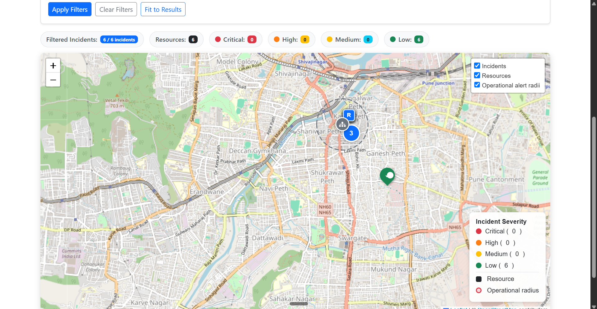
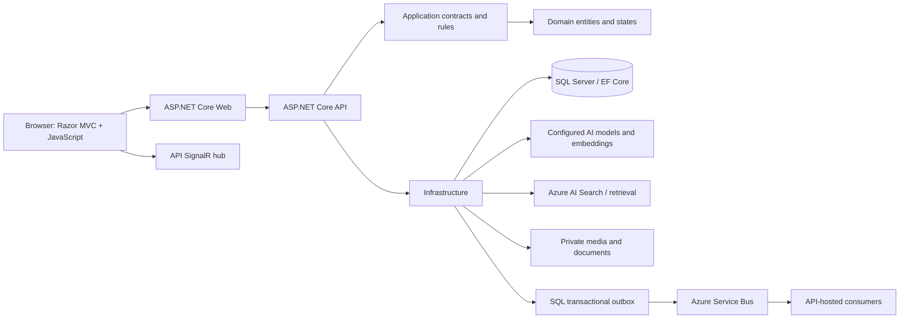

# AI Emergency Response & Disaster Management Platform

Six-slide portfolio presentation. Speaker guidance appears under each slide. Facts reflect the repository and its dated local evidence. The DEMO18 records are synthetic exercise fixtures.

## Slide 1 — AI Emergency Response & Disaster Management

**Portfolio project**

Local synthetic-data demonstration
.NET 10, ASP.NET Core, SQL Server

This is an engineering demonstration, not an operational emergency service.

**Speaker guidance:** Introduce the coordination problem and set the boundary: the platform supports a portfolio walkthrough; it is not connected to real emergency authorities and is not approved for live operations.

## Slide 2 — Emergency operations workflow

- Residents submit incident reports with location and reported facts.
- Authorized reviewers inspect status, impact, related reports, and uncertainty.
- The dashboard and map present incident and resource context.
- Human permissions govern operational commands; AI output remains advisory.

**Intended users:** Citizens reporting incidents; Responders and Operators reviewing work; EmergencyAdmin and SystemAdmin users with higher-level controls.

**Speaker guidance:** Explain that a report is an observation, not a verified fact. Show the distinction between unknown counts and zero. Mention that DEMO18's overlap is a manual exercise grouping, not a confirmed duplicate or automatic cluster.

## Slide 3 — Application capabilities and available evidence

The application includes incident reporting and review, an operations dashboard, a Leaflet map, a resource command center, Copilot, situations, and recipient-scoped notifications.

**Evidence caption:** Actual Operator capture from 2026-10-15. It shows six synthetic incidents/resources and the configured map layers. It predates Parts 2.3.4–2.3.5 UI polish, has clipped attribution, and does not show drawer selection, layer toggling, or SignalR recovery. Current final-state screenshots remain pending.

**Speaker guidance:** Use the image only as limited historical evidence. The current walkthrough should use the live local app when browser access and migrations are available. If it is not available, describe the workflow from source and evidence docs without claiming a live demo.

## Slide 4 — Architecture and technology

**Stack:** C# and .NET 10, ASP.NET Core MVC/Web API, EF Core, SQL Server, Razor, JavaScript, SignalR, Bootstrap, Syncfusion, Leaflet, Azure AI integrations, ML.NET, xUnit, Docker, and Bicep.

**Speaker guidance:** The Web app calls the API, while the browser currently connects directly to the API SignalR hub. The API hosts consumers for selected jobs; there is no standalone Worker host, and some queues remain process-local.

## Slide 5 — AI assistance, evidence, and permissions

- AI extraction and Copilot can depend on configured external providers and knowledge Search.
- Show actual grounding and citation state. An unavailable provider is an unavailable result.
- Deterministic rules calculate severity/priority; AI output does not dispatch resources.
- Copilot proposals require explicit approval and revalidation. Current executors support notes or tags, not dispatch.
- Human review remains necessary for uncertain reports, overlapping counts, and operational decisions.

**Speaker guidance:** The seeded dataset contains no generated AI output. The three linked flood reports are manually grouped and their reported counts can overlap. A visible notification fixture does not prove delivery. Never invent citations, predictions, or provider success.

## Slide 6 — Engineering evidence and release status

**Local release-preparation checks, 17 Oct 2026:** Release build passed with 49 warnings and 0 errors; 572 unit tests passed; 89 isolated SQL integration tests passed; 28 UI JavaScript checks passed; four JavaScript syntax checks passed. Warnings include existing package advisories and nullable-reference warnings.

**Release boundary:** No verified public host or Azure staging deployment. Browser and responsive acceptance remain pending. Durable-job recovery, model quality, several security/recovery paths, video scanning/tooling, and pilot acceptance remain open. Current API startup requires the database migrations to be applied explicitly in Development.

**Speaker guidance:** These tests establish their asserted code paths, not production capacity, visual rendering, live AI quality, or operational readiness. Close with the next step: resolve the local migration target, run the real local walkthrough, capture corrected screens, and continue the release-readiness checks. Azure deployment remains out of scope.

## Sources and evidence boundaries

- Repository overview and architecture: [README.md](../../README.md).
- Local setup and migration instructions: [demo-script.md](demo-script.md).
- Synthetic fixture lifecycle: [synthetic-demo-data.md](synthetic-demo-data.md).
- Feature classifications and release status: [feature-verification.md](feature-verification.md).
- UI and viewport status: [ui-ux-verification.md](ui-ux-verification.md).
- Image provenance and capture limits: [screenshots/README.md](screenshots/README.md).

The screenshot on slide 3 is the original indexed application image, not a current-state capture. No external facts or fabricated application results are included.
